# Evidence

Evidence per competency band. Each section lists what exists, where to find it, and what is still open.

## A1: Requirements

**Done**

- Requirements are managed on a GitHub Project board (`IsItDown?`), linked to the repository.
- Statuses: Backlog, Todo, In Progress, In Review, Done. The board workflows add new issues to Backlog and move them to Done when an issue is closed or its pull request is merged.
- Issue templates for user stories and tasks, plus six labels (`user-story`, `feature`, `ci`, `docs`, `chore`, `bug`).
- Three user stories with acceptance criteria: [#7](https://github.com/TheVCrafter/isitdown/issues/7) (check whether a website is up or down), [#8](https://github.com/TheVCrafter/isitdown/issues/8) (history and uptime) and [#9](https://github.com/TheVCrafter/isitdown/issues/9) (automated testing, build and deployment). Each story is broken into five sub-issues (#10 to #14, #15 to #19 and #20 to #24), so its progress is visible on the story. Three more issues (#25 to #27) cover the requirements tool comparison, the development environment extension and the final documentation.
- Stories #7 and #8 are finished: their sub-issues were closed by pull requests (#13 was closed with a comment that links to the tests that cover it), and each story was closed with a comment that maps its acceptance criteria to the issues and code that cover them.
- Traceability example: issue [#2](https://github.com/TheVCrafter/isitdown/issues/2) (CI workflow) → branch `ci/2-add-workflow` → pull request [#3](https://github.com/TheVCrafter/isitdown/pull/3) with `Closes #2` → merged → issue closed and moved to Done automatically.

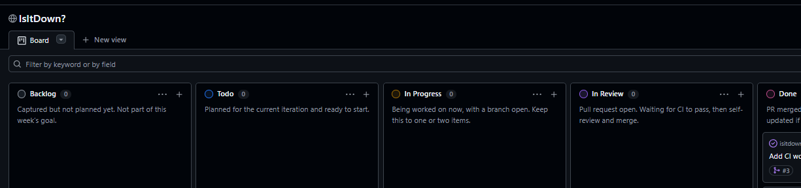

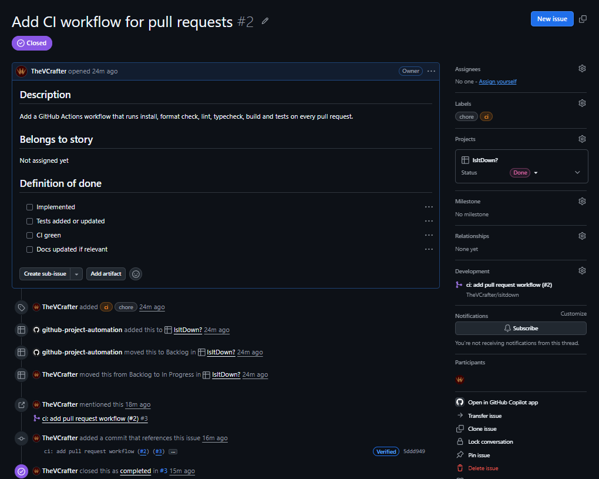

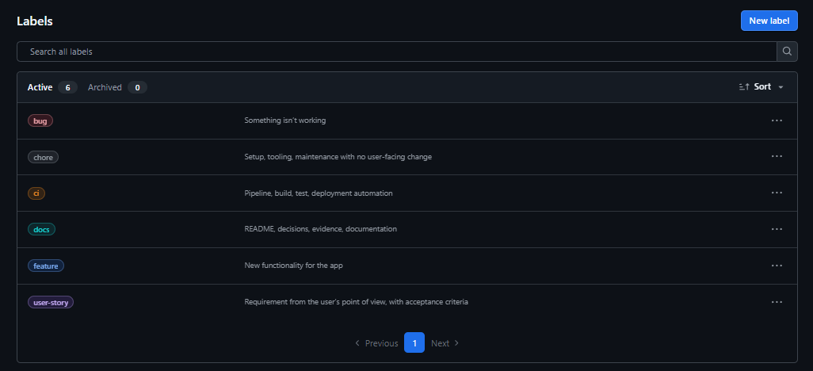

**Open**

- Comparison of requirements management tools (#25).
- A board screenshot that shows the stories with their sub-issues and progress.

## B1: Development environment

**Done**

- Node.js, TypeScript (strict), ESLint, Prettier, Vitest and npm scripts for `lint`, `format`, `format:check`, `typecheck`, `build`, `test` and `test:integration`.
- Editor and line ending setup: `.editorconfig`, `.gitattributes`, `.prettierrc` and shared VS Code settings in `.vscode/settings.json`.
- Two TypeScript configs: `tsconfig.json` covers `src` and `tests` for the editor and `typecheck`; `tsconfig.build.json` builds only `src`.
- Two Vitest configs: `vitest.config.ts` runs the unit tests, and `vitest.integration.config.ts` runs only the integration test.
- Setup steps for a fresh clone are in the [README](../README.md#setup); the reasons for the choices are in [decisions](decisions.md) and [TypeScript notes](typescript-notes.md).
- Setup commit: [`56daa85`](https://github.com/TheVCrafter/isitdown/commit/56daa85).

**Open**

- An extension beyond the basic setup (for example pre-commit hooks or a devcontainer), documented with its reason (#26).

## C1: Source and artifact management

**Done**

- Workflow: issue → branch `type/<issue>-short-name` → small commits referencing the issue → pull request with `Closes #n` → CI green → squash merge → branch deleted automatically. Described in the [README](../README.md#workflow).
- `main` is protected by the ruleset `Protect main`: pull request required, the `build-and-test` check required, force pushes and deletions blocked, empty bypass list.
- Example: pull request [#3](https://github.com/TheVCrafter/isitdown/pull/3), squash merged as [`5ddd949`](https://github.com/TheVCrafter/isitdown/commit/5ddd949).
- A release workflow ([workflow file](../.github/workflows/release.yml)) builds a Docker image when a version tag is pushed and publishes it to the GitHub container registry. The image is tagged with the version and the commit, and labelled with its source repository and commit hash, so it can be traced back to its source.

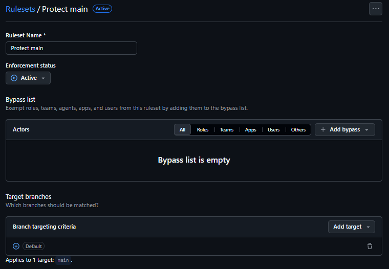

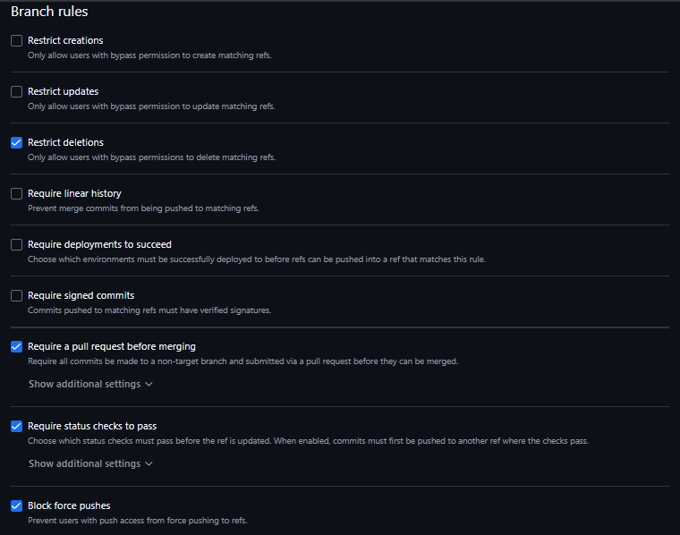

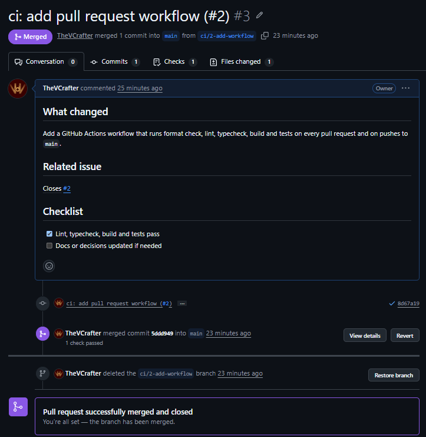

- First release: the tag `v0.1.1` started the release workflow, which published the image to the container registry with the tags `0.1.1`, `0.1`, `latest` and `sha-333019d`, the commit it was built from. The first tag, `v0.1.0`, failed because the Dockerfile was missing from the repository. It was added in a separate pull request, and the release was repeated with a new tag.

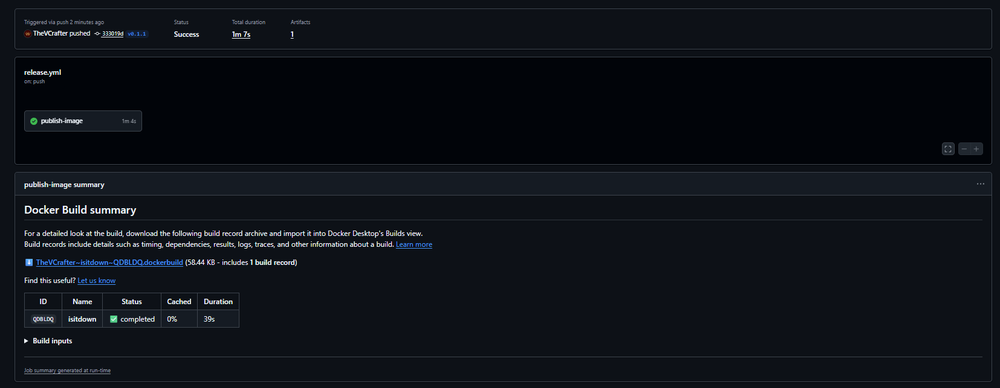

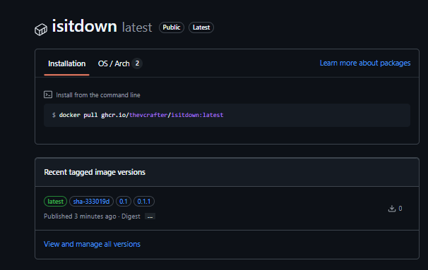

**Open**

- None for now. The deployed version will be shown after the first automatic deployment (#23).

## D1: Integration and testing

**Done**

- Unit tests for the check logic (status rule, URL validation, the check with fake `fetch` functions for 2xx, 3xx, 4xx, 5xx, network error and timeout, and the output format). None of them use the real network.
- Tests for the SQLite storage use an in-memory database: a responded and a failed result come back unchanged, the history is newest first, results are separated by URL, and an unknown URL returns an empty list. One test uses a temporary file database to show that results survive closing and reopening it.
- Tests for the configuration and the scheduler: the interval and port settings accept valid values and reject invalid ones; the scheduler runs a round immediately, runs again after one interval, stops when asked, skips a tick while a round is still running, and reports a failing check or save without stopping the other URLs. The scheduler tests use fake timers and an in-memory storage.
- Tests for the uptime calculation: an empty list and a list without results in the period return `null`; all up, all down, half up and two thirds up return 100, 0, 50 and 66.7; results older than the period and results after the current time are ignored; a result exactly at the start of the period counts; a failed check counts as down.
- Tests for the history report and the selectable periods: the report contains only the results of the requested URL inside the period, newest first, with the matching uptime; the period names `1h`, `24h` and `7d` map to their durations, a missing period uses the default, and unknown names (including `constructor`) are rejected.
- Tests for the history server start the real server on a free port and send real HTTP requests: the report for a stored URL, the default period, a URL without trailing slash, a missing or invalid URL, an unknown period, another path, a request that is not GET, the history page, and a failing storage that answers 500 without leaking the error message.
- An automated integration test runs the real checker, a real SQLite storage and the real history server against a local target server with four routes: a working page, a server error (500), a redirect, and a page that never answers. It checks the whole chain from the check to the report: the working page is up with 100 percent uptime, the server error is down with HTTP 500, the redirect is followed and reported as up, and the hanging page becomes a failed result that is stored and reported. The test runs as its own job in the pipeline, next to the unit tests, and needs no internet access.

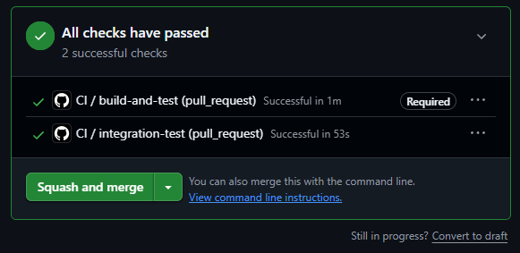

- A run of the monitor with a 5 second interval, followed by a query of the database: the stored results of both runs are in the same file, which shows that results survive a restart.

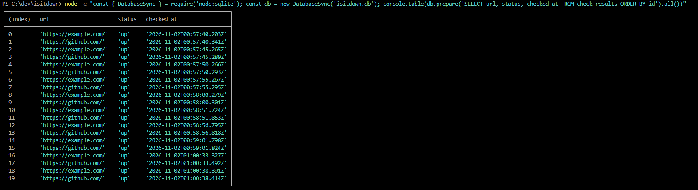

- Demonstration of the story "Check whether a website is up or down":

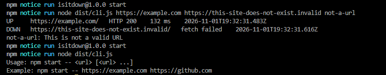

- Demonstration of the story "See the history and uptime of a monitored website": the page shows the uptime and the list of results of a monitored URL.

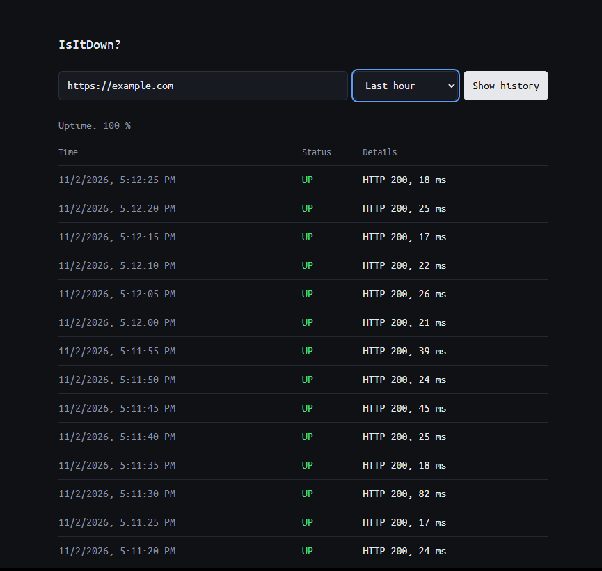

- The pipeline runs two jobs on every pull request and on every push to `main`: `build-and-test` (format check, lint, typecheck, build and unit tests) and `integration-test` ([workflow file](../.github/workflows/ci.yml)).
- A passing run on pull request #3:

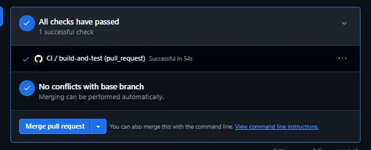

- A pull request with a deliberately failing test was blocked from merging, because `build-and-test` is a required check. The pull request was closed without merging.

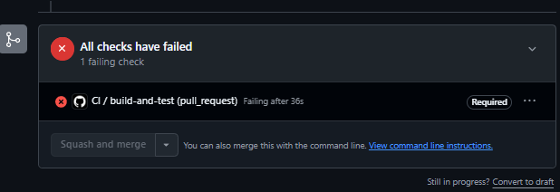

**Open**

- None for now. The health check after a deployment is planned in #24 (E1).

## E1: Deployment

**Done**

- The hosting options are compared in [hosting](hosting.md): a Docker container on a server over SSH, a container platform, the own computer with a self-hosted runner, and GitHub Pages. The decision is a Docker container on a Linux server, because the pipeline can then set up the whole runtime.
- The server is an Oracle Cloud Always Free VM (Ubuntu 24.04, `x86_64`, 1 GB of memory). A key pair was created for the deployment, and the login with the key was tested.

**Open**

- Automatic deployment on merge or tag, including the runtime setup (#23).
- Health endpoint and post-deployment check (#24).
